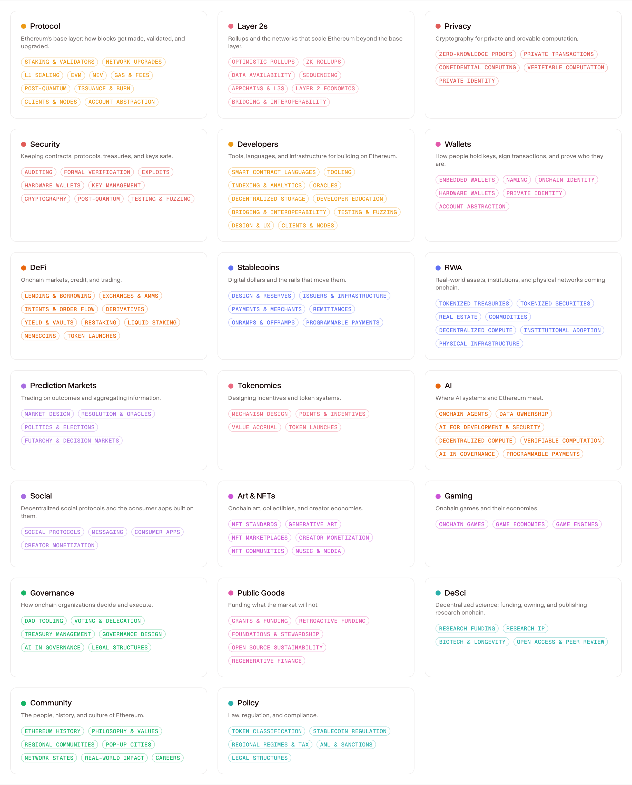

# The Ethereum TV taxonomy

A content map for a decade of Ethereum: **20 topics, 109 subtopics, and the reasoning behind every one of them.**

[Ethereum TV](https://ethereumtv.co) is a searchable archive and TV experience for Ethereum conference talks: protocol deep-dives, interviews, workshops, panels, roughly ten years of recordings heading toward 10,000+ videos. Every one of those talks needs a shelf, and this repository is the shelving system. It is the second piece of Ethereum TV we have open sourced, after the [recommendation algorithm](https://github.com/ethereumtv/algorithm).

We are publishing it because a shared way to categorize Ethereum content is useful beyond one site. If you run an archive, a newsletter, an event, a research library, or anything else that files Ethereum content, you are welcome to use this map, whole or in part, under [CC BY 4.0](#license).

- **[taxonomy.md](taxonomy.md)**: the whole map, human-readable
- **[data/taxonomy.json](data/taxonomy.json)**: machine-readable, one node per topic or subtopic
- **[data/taxonomy.csv](data/taxonomy.csv)**: the same, flat, for spreadsheets
- **[data/aliases.json](data/aliases.json)**: search synonyms that resolve to canonical nodes
- **[CHANGELOG.md](CHANGELOG.md)**: versions

<picture>
  <source media="(prefers-color-scheme: dark)" srcset="media/taxonomy-map-readme.png">
  
</picture>

## The shape of the map

Two levels, and only two.

**Topics** are the 20 top-level categories. They render as pills in Ethereum TV's primary navigation, so their names are short and recognizable: [Protocol](https://ethereumtv.co/topics/protocol), [Layer 2s](https://ethereumtv.co/topics/layer-2), [Privacy](https://ethereumtv.co/topics/privacy), [Security](https://ethereumtv.co/topics/security), [Developers](https://ethereumtv.co/topics/developers), [Wallets](https://ethereumtv.co/topics/wallets), [DeFi](https://ethereumtv.co/topics/defi), [Stablecoins](https://ethereumtv.co/topics/stablecoins), [RWA](https://ethereumtv.co/topics/rwa), [Prediction Markets](https://ethereumtv.co/topics/prediction-markets), [Tokenomics](https://ethereumtv.co/topics/tokenomics), [AI](https://ethereumtv.co/topics/ai), [Social](https://ethereumtv.co/topics/social), [Art & NFTs](https://ethereumtv.co/topics/art), [Gaming](https://ethereumtv.co/topics/gaming), [Governance](https://ethereumtv.co/topics/governance), [Public Goods](https://ethereumtv.co/topics/public-goods), [DeSci](https://ethereumtv.co/topics/desci), [Community](https://ethereumtv.co/topics/community), [Policy](https://ethereumtv.co/topics/policy). Every subtopic is listed and linked the same way in [taxonomy.md](taxonomy.md).

**Subtopics** live underneath and power filtering, related content, and search. Every subtopic carries a one-sentence definition, because a category without a definition becomes whatever each curator guesses it is.

A talk gets one **primary topic** (always top-level) plus any number of tags, which can include other topics as well as subtopics, so a talk that genuinely spans two topics is shelved in both. Level, format, event, language, and year are deliberately **not** in this tree: they cut across every topic, so they live as separate facets. "Beginner DeFi talks from Devcon in Spanish" is four filters combined, not a category.

## The philosophy: less is more

The standing rule during design was a single test, applied to every subtopic:

> Would a viewer actually filter by this, or does the parent topic alone already tell them what they need?

Anything that existed only to make a topic look complete was cut. Anything that needed a written rule to distinguish it from its neighbor was merged with that neighbor. The internal draft that preceded this release had 183 subtopics; the published map has 109. A topic with three subtopics is fine: nobody has to pad a category to make it look serious.

Two hard rules survived every revision. First, **no company names, project names, or token tickers in any name or definition**: projects rise and fall, and the map must not go stale with them. Specific projects belong in video titles, descriptions, and tags, and in [aliases](#aliases-the-vocabulary-the-names-avoid). Second, **every subtopic gets a definition**: one sentence, present tense, no jargon left undefined.

## Shared subtopics

Fourteen subtopics live under two topics at once, marked ⇄ in [taxonomy.md](taxonomy.md). Account Abstraction is protocol engineering and it is the future of wallets; Hardware Wallets are a wallet choice and a security posture. Splitting these into near-duplicate subtopics under each parent would force curators to guess and viewers to check two shelves.

Information architects call this a polyhierarchy, and the Nielsen Norman Group [recommends it](https://www.nngroup.com/articles/polyhierarchy/) for exactly this situation, with one safeguard we adopted wholesale: each shared subtopic has one **home** topic that owns its canonical URL, and it surfaces under at most one other topic. In the data, `parent` is the home and `surfaces_in` is the other topic. Three rules keep the mechanic honest:

1. A shared subtopic has **one definition**, identical on both sides.
2. It appears under **at most two** topics, never three. A subtopic that wants three parents is a sign the hierarchy is wrong, not a reason to loosen the cap.
3. It is **counted once**. Sitewide totals never count a shared subtopic or its videos per surface.

## The map

The whole taxonomy, every name linked to its live page on Ethereum TV. This section is generated straight from the production database by [`scripts/export.mjs`](scripts/export.mjs), so it always matches what the site serves; the same listing ships standalone as [taxonomy.md](taxonomy.md).

<!-- taxonomy:start -->

### 1. [Protocol](https://ethereumtv.co/topics/protocol) `/topics/protocol`

*Ethereum's base layer: how blocks get made, validated, and upgraded.*

- **[Staking & Validators](https://ethereumtv.co/topics/protocol/staking)** `/topics/protocol/staking`: Running validators: hardware, setup, rewards, slashing, and solo, pooled, and distributed operation.
- **[Network Upgrades](https://ethereumtv.co/topics/protocol/upgrades)** `/topics/protocol/upgrades`: Past and planned hard forks, the proposal process behind them, and the long-term roadmap.
- **[L1 Scaling](https://ethereumtv.co/topics/protocol/l1-scaling)** `/topics/protocol/l1-scaling`: Raising what the base layer itself can handle: gas limit increases, state management and statelessness, and proving L1 execution with zero-knowledge proofs.
- **[EVM](https://ethereumtv.co/topics/protocol/evm)** `/topics/protocol/evm`: The Ethereum Virtual Machine and how it evolves: execution, opcodes, state, and bytecode formats.
- **[MEV](https://ethereumtv.co/topics/protocol/mev)** `/topics/protocol/mev`: Value extracted from transaction ordering, and the block-building supply chain around it, including proposer-builder separation and censorship pressure.
- **[Gas & Fees](https://ethereumtv.co/topics/protocol/gas)** `/topics/protocol/gas`: What it costs to use Ethereum: fee markets, gas pricing, and the work to make transactions cheaper.
- **[Issuance & Burn](https://ethereumtv.co/topics/protocol/issuance)** `/topics/protocol/issuance`: Where ETH comes from and where it goes: issuance policy, the burn, net supply, and the monetary debate.
- **[Clients & Nodes](https://ethereumtv.co/topics/protocol/clients)** ⇄ Developers `/topics/protocol/clients`: Client implementations and running them: why diversity protects the network, and how to operate a node or reach one through a provider.
- **[Account Abstraction](https://ethereumtv.co/topics/protocol/account-abstraction)** ⇄ Wallets `/topics/protocol/account-abstraction`: Smart contract accounts, the standards bringing them to every address, and the passkeys, gas sponsorship, and session keys they enable.
- **[Post-Quantum](https://ethereumtv.co/topics/security/post-quantum)** ⇄ *(home: Security)* `/topics/security/post-quantum`: Preparing Ethereum and its applications for quantum attacks: migration paths and quantum-resistant schemes.

### 2. [Layer 2s](https://ethereumtv.co/topics/layer-2) `/topics/layer-2`

*Rollups and the networks that scale Ethereum beyond the base layer.*

- **[Optimistic Rollups](https://ethereumtv.co/topics/layer-2/optimistic-rollups)** `/topics/layer-2/optimistic-rollups`: Rollups that assume validity and rely on fraud proofs to challenge bad state.
- **[ZK Rollups](https://ethereumtv.co/topics/layer-2/zk-rollups)** `/topics/layer-2/zk-rollups`: Rollups that prove every state transition correct before it settles.
- **[Data Availability](https://ethereumtv.co/topics/layer-2/data-availability)** `/topics/layer-2/data-availability`: How rollups publish data so anyone can reconstruct state, including blob space and external availability layers.
- **[Sequencing](https://ethereumtv.co/topics/layer-2/sequencing)** `/topics/layer-2/sequencing`: Who orders L2 transactions: single sequencers, decentralized sequencer networks, and delegating ordering back to L1.
- **[Appchains & L3s](https://ethereumtv.co/topics/layer-2/appchains)** `/topics/layer-2/appchains`: Launching your own chain: application-specific chains, the frameworks to deploy them, and when sovereignty pays off.
- **[Layer 2 Economics](https://ethereumtv.co/topics/layer-2/economics)** `/topics/layer-2/economics`: What it costs to operate an L2, where the fees go, and how value accrues to the chain.
- **[Bridging & Interoperability](https://ethereumtv.co/topics/layer-2/interop)** ⇄ Developers `/topics/layer-2/interop`: Moving assets and messages between chains, bridges and cross-chain intents, and the work to make many chains feel like one balance and one flow.

### 3. [Privacy](https://ethereumtv.co/topics/privacy) `/topics/privacy`

*Cryptography for private and provable computation.*

- **[Zero-Knowledge Proofs](https://ethereumtv.co/topics/privacy/zk-proofs)** `/topics/privacy/zk-proofs`: Proving systems and the tooling to build with them: how they work, what they cost, and the general-purpose virtual machines that prove arbitrary program execution.
- **[Private Transactions](https://ethereumtv.co/topics/privacy/private-transactions)** `/topics/privacy/private-transactions`: Transacting without exposing amounts, counterparties, or history, including hiding transactions before inclusion.
- **[Confidential Computing](https://ethereumtv.co/topics/privacy/confidential-computing)** `/topics/privacy/confidential-computing`: Computing on data you cannot see: secure enclaves, multi-party computation, and homomorphic encryption.
- **[Verifiable Computation](https://ethereumtv.co/topics/privacy/verifiable-computation)** ⇄ AI `/topics/privacy/verifiable-computation`: Proving off-chain work was performed correctly, including machine learning inference.
- **[Private Identity](https://ethereumtv.co/topics/privacy/private-identity)** ⇄ Wallets `/topics/privacy/private-identity`: Proving facts about yourself without revealing the underlying data.

### 4. [Security](https://ethereumtv.co/topics/security) `/topics/security`

*Keeping contracts, protocols, treasuries, and keys safe.*

- **[Auditing](https://ethereumtv.co/topics/security/auditing)** `/topics/security/auditing`: Reviewing contracts for vulnerabilities: methodology, secure patterns, anti-patterns, and how the audit market works.
- **[Formal Verification](https://ethereumtv.co/topics/security/formal-verification)** `/topics/security/formal-verification`: Mathematically proving a contract behaves as specified, rather than testing that it usually does.
- **[Exploits](https://ethereumtv.co/topics/security/exploits)** `/topics/security/exploits`: Breakdowns of past hacks and their post-mortems: how the attack worked and what changed afterward.
- **[Key Management](https://ethereumtv.co/topics/security/key-management)** `/topics/security/key-management`: Protecting keys in practice: secure storage, multisig, recovery, and operational security.
- **[Cryptography](https://ethereumtv.co/topics/security/cryptography)** `/topics/security/cryptography`: Cryptographic primitives in production, including signature schemes and threshold cryptography.
- **[Post-Quantum](https://ethereumtv.co/topics/security/post-quantum)** ⇄ Protocol `/topics/security/post-quantum`: Preparing Ethereum and its applications for quantum attacks: migration paths and quantum-resistant schemes.
- **[Testing & Fuzzing](https://ethereumtv.co/topics/security/testing)** ⇄ Developers `/topics/security/testing`: Finding bugs automatically through fuzzing, invariant testing, coverage, and simulation against live state.
- **[Hardware Wallets](https://ethereumtv.co/topics/wallets/hardware-wallets)** ⇄ *(home: Wallets)* `/topics/wallets/hardware-wallets`: Physical signing devices: their security architecture, how they differ, and how to choose between them.

### 5. [Developers](https://ethereumtv.co/topics/developers) `/topics/developers`

*Tools, languages, and infrastructure for building on Ethereum.*

- **[Smart Contract Languages](https://ethereumtv.co/topics/developers/languages)** `/topics/developers/languages`: Languages for writing contracts, their trade-offs, and what changes between versions.
- **[Tooling](https://ethereumtv.co/topics/developers/tooling)** `/topics/developers/tooling`: Toolchains for compiling, deploying, scripting, and managing contract projects.
- **[Indexing & Analytics](https://ethereumtv.co/topics/developers/indexing)** `/topics/developers/indexing`: Turning raw chain data into queryable APIs, dashboards, and research.
- **[Oracles](https://ethereumtv.co/topics/developers/oracles)** `/topics/developers/oracles`: Bringing off-chain data on-chain, the trust assumptions involved, and the attacks that target them.
- **[Decentralized Storage](https://ethereumtv.co/topics/developers/storage)** `/topics/developers/storage`: Storing files and data off-chain in permanent or distributed systems.
- **[Developer Education](https://ethereumtv.co/topics/developers/education)** `/topics/developers/education`: Learning paths, bootcamps, and getting productive as a developer new to Ethereum.
- **[Design & UX](https://ethereumtv.co/topics/developers/ux)** `/topics/developers/ux`: Designing usable crypto products: interface patterns, user research, and the craft of making self-custody and onchain flows understandable.
- **[Bridging & Interoperability](https://ethereumtv.co/topics/layer-2/interop)** ⇄ *(home: Layer 2s)* `/topics/layer-2/interop`: Moving assets and messages between chains, bridges and cross-chain intents, and the work to make many chains feel like one balance and one flow.
- **[Testing & Fuzzing](https://ethereumtv.co/topics/security/testing)** ⇄ *(home: Security)* `/topics/security/testing`: Finding bugs automatically through fuzzing, invariant testing, coverage, and simulation against live state.
- **[Clients & Nodes](https://ethereumtv.co/topics/protocol/clients)** ⇄ *(home: Protocol)* `/topics/protocol/clients`: Client implementations and running them: why diversity protects the network, and how to operate a node or reach one through a provider.

### 6. [Wallets](https://ethereumtv.co/topics/wallets) `/topics/wallets`

*How people hold keys, sign transactions, and prove who they are.*

- **[Embedded Wallets](https://ethereumtv.co/topics/wallets/embedded-wallets)** `/topics/wallets/embedded-wallets`: Wallets built directly into applications so users never install a separate app or see a seed phrase.
- **[Naming](https://ethereumtv.co/topics/wallets/naming)** `/topics/wallets/naming`: Human-readable names for accounts, the records attached to them, and naming as identity.
- **[Onchain Identity](https://ethereumtv.co/topics/wallets/identity)** `/topics/wallets/identity`: Proving who you are and what you have done onchain: credentials, attestations, wallet-based sign-in, reputation, and proving you are a unique human.
- **[Hardware Wallets](https://ethereumtv.co/topics/wallets/hardware-wallets)** ⇄ Security `/topics/wallets/hardware-wallets`: Physical signing devices: their security architecture, how they differ, and how to choose between them.
- **[Private Identity](https://ethereumtv.co/topics/privacy/private-identity)** ⇄ *(home: Privacy)* `/topics/privacy/private-identity`: Proving facts about yourself without revealing the underlying data.
- **[Account Abstraction](https://ethereumtv.co/topics/protocol/account-abstraction)** ⇄ *(home: Protocol)* `/topics/protocol/account-abstraction`: Smart contract accounts, the standards bringing them to every address, and the passkeys, gas sponsorship, and session keys they enable.

### 7. [DeFi](https://ethereumtv.co/topics/defi) `/topics/defi`

*Onchain markets, credit, and trading.*

- **[Lending & Borrowing](https://ethereumtv.co/topics/defi/lending)** `/topics/defi/lending`: Permissionless credit markets, collateral models, and the risk engines that keep them solvent.
- **[Exchanges & AMMs](https://ethereumtv.co/topics/defi/exchanges)** `/topics/defi/exchanges`: Decentralized trading venues, market maker design, and the strategy of providing liquidity to them.
- **[Intents & Order Flow](https://ethereumtv.co/topics/defi/intents)** `/topics/defi/intents`: Trading by stating a desired outcome rather than a route, and the solvers competing to fill it.
- **[Derivatives](https://ethereumtv.co/topics/defi/derivatives)** `/topics/defi/derivatives`: Onchain leverage, perpetuals, futures, options, and synthetic exposure.
- **[Yield & Vaults](https://ethereumtv.co/topics/defi/yield)** `/topics/defi/yield`: Strategies and automated vaults for earning returns, and where the yield actually comes from.
- **[Restaking](https://ethereumtv.co/topics/defi/restaking)** `/topics/defi/restaking`: Reusing staked ETH to secure additional networks, and the cascading risk it introduces.
- **[Liquid Staking](https://ethereumtv.co/topics/defi/liquid-staking)** `/topics/defi/liquid-staking`: Protocols that issue tradable tokens against staked ETH, and their governance and risk profiles.
- **[Memecoins](https://ethereumtv.co/topics/defi/memecoins)** `/topics/defi/memecoins`: Meme tokens as markets and culture: launchpad mechanics, attention-driven trading, and what their cycles reveal about onchain speculation.
- **[Token Launches](https://ethereumtv.co/topics/defi/token-launches)** ⇄ Tokenomics `/topics/defi/token-launches`: How new tokens reach holders: launchpads, fair launches, airdrops, vesting, and lockups.

### 8. [Stablecoins](https://ethereumtv.co/topics/stablecoins) `/topics/stablecoins`

*Digital dollars and the rails that move them.*

- **[Design & Reserves](https://ethereumtv.co/topics/stablecoins/design-reserves)** `/topics/stablecoins/design-reserves`: How a peg is held and backed: collateral models, algorithmic mechanisms, reserve composition, attestation, and designs that pass yield to holders.
- **[Issuers & Infrastructure](https://ethereumtv.co/topics/stablecoins/issuers)** `/topics/stablecoins/issuers`: Who issues digital dollars and where they run: bank and fintech issuance, dedicated stablecoin chains, and the settlement rails underneath.
- **[Payments & Merchants](https://ethereumtv.co/topics/stablecoins/payments)** `/topics/stablecoins/payments`: Accepting crypto for real purchases, in person and online, including card network integration.
- **[Remittances](https://ethereumtv.co/topics/stablecoins/remittances)** `/topics/stablecoins/remittances`: Cross-border transfers and the corridors where onchain rails beat traditional providers.
- **[Onramps & Offramps](https://ethereumtv.co/topics/stablecoins/ramps)** `/topics/stablecoins/ramps`: Moving between bank money and onchain money, and why exiting is harder than entering.
- **[Programmable Payments](https://ethereumtv.co/topics/stablecoins/programmable-payments)** ⇄ AI `/topics/stablecoins/programmable-payments`: Payments with logic attached or initiated by software: escrow, subscriptions, streaming, and machine-to-machine micropayments.

### 9. [RWA](https://ethereumtv.co/topics/rwa) `/topics/rwa`

*Real-world assets, institutions, and physical networks coming onchain.*

- **[Tokenized Treasuries](https://ethereumtv.co/topics/rwa/treasuries)** `/topics/rwa/treasuries`: Government debt and money market funds issued and traded onchain.
- **[Tokenized Securities](https://ethereumtv.co/topics/rwa/securities)** `/topics/rwa/securities`: Equities, bonds, and credit represented as onchain instruments, including private credit and invoice finance.
- **[Real Estate](https://ethereumtv.co/topics/rwa/real-estate)** `/topics/rwa/real-estate`: Fractional property ownership onchain and the legal structures that make it enforceable.
- **[Commodities](https://ethereumtv.co/topics/rwa/commodities)** `/topics/rwa/commodities`: Gold, carbon, and other physical goods represented as onchain claims.
- **[Institutional Adoption](https://ethereumtv.co/topics/rwa/institutions)** `/topics/rwa/institutions`: Banks, asset managers, and corporates building on public chains, including permissioned pools, settlement, and regulated products such as exchange-traded funds.
- **[Physical Infrastructure](https://ethereumtv.co/topics/rwa/physical-infrastructure)** `/topics/rwa/physical-infrastructure`: Crypto-incentivized real-world hardware: wireless coverage, mapping and sensors, and distributed energy.
- **[Decentralized Compute](https://ethereumtv.co/topics/ai/compute)** ⇄ *(home: AI)* `/topics/ai/compute`: Distributed GPU and compute markets: how the networks are built and whether they can serve real workloads.

### 10. [Prediction Markets](https://ethereumtv.co/topics/prediction-markets) `/topics/prediction-markets`

*Trading on outcomes and aggregating information.*

- **[Market Design](https://ethereumtv.co/topics/prediction-markets/market-design)** `/topics/prediction-markets/market-design`: How outcome markets are built and whether they forecast well: pricing rules, liquidity, settlement, and the limits of thin markets.
- **[Resolution & Oracles](https://ethereumtv.co/topics/prediction-markets/resolution)** `/topics/prediction-markets/resolution`: Deciding what actually happened, and what happens when that decision is disputed.
- **[Politics & Elections](https://ethereumtv.co/topics/prediction-markets/elections)** `/topics/prediction-markets/elections`: Markets on political outcomes, their accuracy record, and their influence on coverage.
- **[Futarchy & Decision Markets](https://ethereumtv.co/topics/prediction-markets/futarchy)** `/topics/prediction-markets/futarchy`: Using markets rather than votes to choose between courses of action.

### 11. [Tokenomics](https://ethereumtv.co/topics/tokenomics) `/topics/tokenomics`

*Designing incentives and token systems.*

- **[Mechanism Design](https://ethereumtv.co/topics/tokenomics/mechanism-design)** `/topics/tokenomics/mechanism-design`: Designing rules, auctions, and curves so self-interested participants produce the outcome you wanted.
- **[Points & Incentives](https://ethereumtv.co/topics/tokenomics/incentives)** `/topics/tokenomics/incentives`: Pre-token incentive campaigns, farming behavior, and what happens when they end.
- **[Value Accrual](https://ethereumtv.co/topics/tokenomics/value-accrual)** `/topics/tokenomics/value-accrual`: Whether and how a token captures the value the protocol it governs creates.
- **[Token Launches](https://ethereumtv.co/topics/defi/token-launches)** ⇄ *(home: DeFi)* `/topics/defi/token-launches`: How new tokens reach holders: launchpads, fair launches, airdrops, vesting, and lockups.

### 12. [AI](https://ethereumtv.co/topics/ai) `/topics/ai`

*Where AI systems and Ethereum meet.*

- **[Onchain Agents](https://ethereumtv.co/topics/ai/agents)** `/topics/ai/agents`: Autonomous software that holds keys and transacts without a human in the loop.
- **[Data Ownership](https://ethereumtv.co/topics/ai/data-ownership)** `/topics/ai/data-ownership`: Collectively owned datasets, data cooperatives, and marketplaces for training data.
- **[AI for Development & Security](https://ethereumtv.co/topics/ai/ai-development)** `/topics/ai/ai-development`: Using models to write, review, and audit contracts, and where they fall short.
- **[Decentralized Compute](https://ethereumtv.co/topics/ai/compute)** ⇄ RWA `/topics/ai/compute`: Distributed GPU and compute markets: how the networks are built and whether they can serve real workloads.
- **[Verifiable Computation](https://ethereumtv.co/topics/privacy/verifiable-computation)** ⇄ *(home: Privacy)* `/topics/privacy/verifiable-computation`: Proving off-chain work was performed correctly, including machine learning inference.
- **[AI in Governance](https://ethereumtv.co/topics/governance/ai-governance)** ⇄ *(home: Governance)* `/topics/governance/ai-governance`: Delegating votes to agents and using models to summarize and triage proposals.
- **[Programmable Payments](https://ethereumtv.co/topics/stablecoins/programmable-payments)** ⇄ *(home: Stablecoins)* `/topics/stablecoins/programmable-payments`: Payments with logic attached or initiated by software: escrow, subscriptions, streaming, and machine-to-machine micropayments.

### 13. [Social](https://ethereumtv.co/topics/social) `/topics/social`

*Decentralized social protocols and the consumer apps built on them.*

- **[Social Protocols](https://ethereumtv.co/topics/social/social-protocols)** `/topics/social/social-protocols`: Networks where the social graph and content are not owned by a single company, and the portability and embedded apps that follow.
- **[Messaging](https://ethereumtv.co/topics/social/messaging)** `/topics/social/messaging`: Wallet-to-wallet and decentralized messaging protocols.
- **[Consumer Apps](https://ethereumtv.co/topics/social/consumer-apps)** `/topics/social/consumer-apps`: Mainstream-facing crypto products and what separates the ones that stick.
- **[Creator Monetization](https://ethereumtv.co/topics/social/creators)** ⇄ Art & NFTs `/topics/social/creators`: How creators earn directly from an audience: tips, social tokens, subscriptions, drops, and royalties.

### 14. [Art & NFTs](https://ethereumtv.co/topics/art) `/topics/art`

*Onchain art, collectibles, and creator economies.*

- **[NFT Standards](https://ethereumtv.co/topics/art/nft-standards)** `/topics/art/nft-standards`: Token standards for unique and semi-fungible assets, including tokens that hold assets or change over time.
- **[Generative Art](https://ethereumtv.co/topics/art/generative-art)** `/topics/art/generative-art`: Algorithmic art created, stored, and rendered onchain.
- **[NFT Marketplaces](https://ethereumtv.co/topics/art/marketplaces)** `/topics/art/marketplaces`: Where NFTs and collectibles trade, and the economics of those venues.
- **[NFT Communities](https://ethereumtv.co/topics/art/nft-communities)** `/topics/art/nft-communities`: Collections as identity, membership, and social signal, from profile pictures to collector communities.
- **[Music & Media](https://ethereumtv.co/topics/art/music)** `/topics/art/music`: Onchain releases, rights, and direct-to-fan models for musicians and filmmakers.
- **[Creator Monetization](https://ethereumtv.co/topics/social/creators)** ⇄ *(home: Social)* `/topics/social/creators`: How creators earn directly from an audience: tips, social tokens, subscriptions, drops, and royalties.

### 15. [Gaming](https://ethereumtv.co/topics/gaming) `/topics/gaming`

*Onchain games and their economies.*

- **[Onchain Games](https://ethereumtv.co/topics/gaming/onchain-games)** `/topics/gaming/onchain-games`: Games whose state and logic live on a blockchain, including persistent autonomous worlds that run without an owner.
- **[Game Economies](https://ethereumtv.co/topics/gaming/game-economies)** `/topics/gaming/game-economies`: Designing sustainable in-game currencies and tradeable items that players genuinely own.
- **[Game Engines](https://ethereumtv.co/topics/gaming/game-engines)** `/topics/gaming/game-engines`: Frameworks and engines for building games whose state lives onchain.

### 16. [Governance](https://ethereumtv.co/topics/governance) `/topics/governance`

*How onchain organizations decide and execute.*

- **[DAO Tooling](https://ethereumtv.co/topics/governance/dao-tooling)** `/topics/governance/dao-tooling`: Software for running an organization onchain: proposals, execution, membership, and payroll.
- **[Voting & Delegation](https://ethereumtv.co/topics/governance/voting)** `/topics/governance/voting`: How votes are cast, weighted, and handed to representatives, including quadratic and conviction schemes.
- **[Treasury Management](https://ethereumtv.co/topics/governance/treasury-management)** `/topics/governance/treasury-management`: Holding, diversifying, and deploying an organization's assets responsibly.
- **[Governance Design](https://ethereumtv.co/topics/governance/governance-design)** `/topics/governance/governance-design`: Voter apathy, capture, minimization, token design, and what makes a decision legitimate.
- **[AI in Governance](https://ethereumtv.co/topics/governance/ai-governance)** ⇄ AI `/topics/governance/ai-governance`: Delegating votes to agents and using models to summarize and triage proposals.
- **[Legal Structures](https://ethereumtv.co/topics/policy/legal-structures)** ⇄ *(home: Policy)* `/topics/policy/legal-structures`: Legal wrappers that give an onchain organization standing in the offline world.

### 17. [Public Goods](https://ethereumtv.co/topics/public-goods) `/topics/public-goods`

*Funding what the market will not.*

- **[Grants & Funding](https://ethereumtv.co/topics/public-goods/grants)** `/topics/public-goods/grants`: Programs that fund builders and maintainers directly, including quadratic matching and how to run a round well.
- **[Retroactive Funding](https://ethereumtv.co/topics/public-goods/retro-funding)** `/topics/public-goods/retro-funding`: Rewarding work after its value is proven rather than funding promises in advance.
- **[Foundations & Stewardship](https://ethereumtv.co/topics/public-goods/foundations)** `/topics/public-goods/foundations`: The role, strategy, and spending of the institutions that steward the ecosystem.
- **[Open Source Sustainability](https://ethereumtv.co/topics/public-goods/open-source)** `/topics/public-goods/open-source`: Keeping maintainers paid and projects alive beyond initial enthusiasm.
- **[Regenerative Finance](https://ethereumtv.co/topics/public-goods/regenerative-finance)** `/topics/public-goods/regenerative-finance`: Using onchain incentives for environmental and social outcomes, and the critiques of doing so.

### 18. [DeSci](https://ethereumtv.co/topics/desci) `/topics/desci`

*Decentralized science: funding, owning, and publishing research onchain.*

- **[Research Funding](https://ethereumtv.co/topics/desci/research-funding)** `/topics/desci/research-funding`: Funding science with onchain capital, from grant DAOs to community-owned research treasuries.
- **[Research IP](https://ethereumtv.co/topics/desci/research-ip)** `/topics/desci/research-ip`: Turning intellectual property and research assets into onchain instruments that can be owned and traded.
- **[Biotech & Longevity](https://ethereumtv.co/topics/desci/biotech)** `/topics/desci/biotech`: Community-funded biotech, longevity research, and the DAOs organizing it.
- **[Open Access & Peer Review](https://ethereumtv.co/topics/desci/publishing)** `/topics/desci/publishing`: Rebuilding publishing and review with onchain incentives and open data.

### 19. [Community](https://ethereumtv.co/topics/community) `/topics/community`

*The people, history, and culture of Ethereum.*

- **[Ethereum History](https://ethereumtv.co/topics/community/history)** `/topics/community/history`: Origin stories and the moments that shaped the network.
- **[Philosophy & Values](https://ethereumtv.co/topics/community/philosophy)** `/topics/community/philosophy`: Cypherpunk roots, credible neutrality, and the arguments about what Ethereum is for.
- **[Regional Communities](https://ethereumtv.co/topics/community/regions)** `/topics/community/regions`: Local ecosystems worldwide: how they form, what they build, and what they need.
- **[Pop-Up Cities](https://ethereumtv.co/topics/community/pop-up-cities)** `/topics/community/pop-up-cities`: Temporary, experimental communities that gather for weeks or months to test new ways of living and coordinating.
- **[Network States](https://ethereumtv.co/topics/community/network-states)** `/topics/community/network-states`: Digitally organized communities pursuing lasting institutions, territory, and recognition as new kinds of states.
- **[Real-World Impact](https://ethereumtv.co/topics/community/impact)** `/topics/community/impact`: Ethereum in use where it matters: financial inclusion, emerging markets, humanitarian applications, and what product-market fit looks like on the ground.
- **[Careers](https://ethereumtv.co/topics/community/careers)** `/topics/community/careers`: Getting hired, contributing, and building a professional path in the ecosystem.

### 20. [Policy](https://ethereumtv.co/topics/policy) `/topics/policy`

*Law, regulation, and compliance.*

- **[Token Classification](https://ethereumtv.co/topics/policy/token-classification)** `/topics/policy/token-classification`: When a token counts as a security, the tests that decide it, and the enforcement cases that set precedent.
- **[Stablecoin Regulation](https://ethereumtv.co/topics/policy/stablecoin-regulation)** `/topics/policy/stablecoin-regulation`: Rules for issuers of digital dollars, and state-issued digital money alongside them.
- **[Regional Regimes & Tax](https://ethereumtv.co/topics/policy/jurisdictions)** `/topics/policy/jurisdictions`: How individual jurisdictions approach crypto, including how activity is taxed.
- **[AML & Sanctions](https://ethereumtv.co/topics/policy/aml)** `/topics/policy/aml`: Know-your-customer and anti-money-laundering obligations, and where privacy tools meet sanctions enforcement.
- **[Legal Structures](https://ethereumtv.co/topics/policy/legal-structures)** ⇄ Governance `/topics/policy/legal-structures`: Legal wrappers that give an onchain organization standing in the offline world.

<!-- taxonomy:end -->

## Slugs

Every node has a URL slug: lowercase, hyphenated, ASCII, one to three words, globally unique across the whole map (topics and subtopics share one namespace). Slugs favor the durable concept over the current phrasing so a display-name rewording never breaks a URL: the slug for Points & Incentives is `incentives`, because points are the trend and incentives are the concept. On Ethereum TV they appear as `ethereumtv.co/topics/{topic}` and `ethereumtv.co/topics/{topic}/{subtopic}`, with a shared subtopic's canonical URL always under its home topic.

## Aliases: the vocabulary the names avoid

Because display names ban project names and trend terms, search has to catch what people actually type. [data/aliases.json](data/aliases.json) is the seed list: DePIN resolves to Physical Infrastructure, Perps to Derivatives, ENS to Naming, Chain Abstraction to Bridging & Interoperability, and so on. Unlike display names, aliases may contain project names and trend terms; that is their entire job. Each alias resolves to exactly one canonical slug, and the list is meant to grow without ever touching the taxonomy itself.

## How the map was validated

Before freezing the taxonomy we ran a verification pass against the outside world, in four directions:

**Conference tracks.** The talks in the archive come from real events, so the map has to hold their programming. We checked it against the track and category systems of Devcon (including the categories of the excellent [Devcon archive](https://archive.devcon.org/), the closest thing to prior art for this project), Devconnect's districts, EthCC, ETHDenver, ETHGlobal, Protocol Berg, and the Science of Blockchain Conference. Every 2025 to 2026 track and district maps cleanly onto these 20 topics. Two genuine gaps that surfaced became subtopics: Design & UX (a full Devcon track that previously had no home here) and Real-World Impact (Devcon's "Real World Ethereum", which, usefully, is not the same thing as RWA).

**Ethereum's own priorities.** The protocol side of the map tracks where Ethereum is actually going, from the Ethereum Foundation's published [protocol priorities](https://blog.ethereum.org/2026/02/18/protocol-priorities-update-2026): L1 Scaling exists because the gas-limit campaign, statelessness, and real-time L1 proving are a named multi-year program; Post-Quantum is shared between Security and Protocol because it became a first-class roadmap workstream, not just a cryptography subject.

**Industry taxonomies.** We compared against the sector maps of Messari, CoinGecko, The Block, Galaxy, a16z crypto, Binance Research, and Coinbase Institutional. Seventeen of the twenty topics have direct industry analogues. The three that do not (Public Goods, Community, and Tokenomics) are exactly the categories a talks archive should have that a markets taxonomy would never need.

**Navigation research.** The structure follows the findability literature rather than taste. The [Baymard Institute's research on product lists and filtering](https://baymard.com/research/ecommerce-product-lists) finds that filter groups work best at roughly 4 to 8 visible options, and that the most common large-catalog failure is overcategorization: splitting what should be one category plus a facet into many sibling categories. This map averages about five and a half subtopics per topic, keeps facets out of the tree, and treats a thin topic as a feature. The shared-subtopic mechanic follows the NN/g polyhierarchy guidance cited above.

## Using the data

`data/taxonomy.json` is one flat array of nodes:

```json
{
  "slug": "account-abstraction",
  "name": "Account Abstraction",
  "parent": "protocol",
  "surfaces_in": "wallets",
  "description": "Smart contract accounts, the standards bringing them to every address, and the passkeys, gas sponsorship, and session keys they enable.",
  "sort_order": 9,
  "color": null
}
```

`parent` is `null` for the 20 top-level topics. `surfaces_in` is non-null on exactly 14 subtopics. `sort_order` is the curated display order within a parent (nav order for topics). `id` is a stable UUID from the production database. `color` is the topic's display color on Ethereum TV; subtopics inherit their parent's. The CSV carries the same fields flat.

## Versioning

The production database is the source of truth, and this repo is an export of it: [`scripts/export.mjs`](scripts/export.mjs) regenerates `data/taxonomy.json`, `data/taxonomy.csv`, and `taxonomy.md` from the live table (a maintainer tool; it reads credentials from the environment). Releases are tagged (this is v1.0.0, taxonomy v14 internally), and every change lands in [CHANGELOG.md](CHANGELOG.md). The 20 topics are stable; subtopics evolve slowly and deliberately, and additions have to pass the viewer-filter test like everything else.

## Contributing

Issues and PRs are welcome, with expectations set honestly: this taxonomy runs a production site, so changes are conservative by design. The most useful contributions are:

- **A missing subtopic with evidence**: real talks, from real events, that have no comfortable shelf today. "Would a viewer filter by this" is the bar.
- **A definition that misleads**: if a definition made you file something wrongly, that is a bug.
- **Aliases**: vocabulary people actually search that does not resolve today. These are the easiest wins, since aliases can grow freely.

Renaming or restructuring topics, adding project names, or folding facets into the tree are the things we will (politely) decline.

## License

The taxonomy data and documentation are licensed [CC BY 4.0](LICENSE): use it anywhere, adapt it freely, credit "Ethereum TV" with a link to this repository or to [ethereumtv.co](https://ethereumtv.co). The helper scripts in `scripts/` are [MIT](scripts/LICENSE).

Built by [Ethereum TV](https://ethereumtv.co). If you use this map somewhere, we would genuinely love to hear about it.
